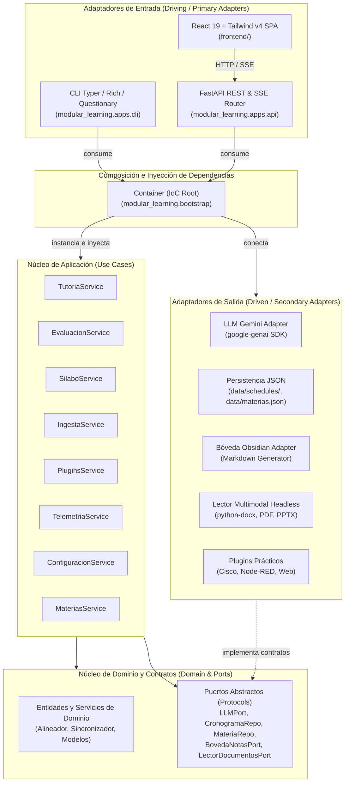

# 🏛️ Arquitectura Hexagonal y Diseño de Sistema - Modular Learning

`modular-learning` es un ecosistema académico inteligente diseñado para la ingesta multimodal de material de estudio, tutoría adaptativa con IA y generación de notas estructuradas para [Obsidian](https://obsidian.md/).

El sistema está estructurado bajo los principios de **Arquitectura Hexagonal (Puertos y Adaptadores)**, **Inversión de Control (IoC)** y **Separación de Responsabilidades (SoC)**, garantizando que el núcleo de negocio sea 100% independiente de marcos de trabajo, interfaces de usuario y servicios externos.

---

## 📐 Diagrama de Arquitectura y Dependencias



---

## 🧩 Capas del Sistema

### 1. Dominio (`modular_learning.core.domain`)
Contiene los modelos de datos y la lógica de negocio pura:
- **`alineador_curricular.py`**: Algoritmos de afinidad semántica y mapeo entre contenidos de clase y documentos complementarios.
- **`sincronizador.py`**: Gestión del ciclo de sincronización y estados de procesamiento del Segundo Cerebro.
- **Modelos**: Tipos inmutables y dataclasses para clases, sílabos, niveles de profundidad y métricas.
- **Regla estricta**: Cero dependencias hacia librerías de infraestructura, frameworks web o SDKs de proveedores.

### 2. Puertos (`modular_learning.core.ports`)
Contratos tipados (`typing.Protocol`) que definen cómo el núcleo interactúa con el mundo exterior:
- **`llm.py` (`LLMPort`)**: Contrato para generación de texto, JSON estructurado y streaming conversacional.
- **`repositorios.py`**: `CronogramaRepo`, `MateriaRepo`, `RegistroMaterialesRepo`.
- **`boveda.py` (`BovedaNotasPort`)**: Creación y organización de notas estructuradas en Markdown.
- **`documentos.py` (`LectorDocumentosPort`)**: Extracción de texto e imágenes desde archivos multiformato.
- **`plugin_practico.py` (`PluginPracticoPort`)**: Módulos de memoria técnica y contexto práctico.
- **`config.py` (`AjustesPort`)**: Resolución de rutas y variables de configuración.

### 3. Aplicación (`modular_learning.core.application`)
Servicios de caso de uso que orquestan los flujos del sistema mediante inyección de dependencias:
- **`TutoriaService`**: Generación de roadmaps pedagógicos progresivos, streaming de explicaciones técnicas por pasos, resolución de dudas inline y síntesis para Obsidian.
- **`EvaluacionService`**: Generador de cuestionarios anti-patrón de recuerdo activo y evaluación formativa.
- **`SilaboService`**: Extracción inteligente de contenidos a partir de sílabos analíticos y estructuración de cronogramas.
- **`IngestaService`**: Procesamiento multimodal headless de documentos (.docx con extracción de diagramas, PDF, PPTX) y alineación curricular.
- **`PluginsService`**: Actualización de memoria técnica especializada (Cisco Packet Tracer, Node-RED, Desarrollo Web).
- **`TelemetriaService`**: Cálculo de rachas de estudio, progreso por asignatura y estadísticas acumuladas.

### 4. Infraestructura (`modular_learning.infrastructure`)
Implementaciones concretas de los puertos secundarios:
- **`infrastructure/llm/gemini_adapter.py`**: Integración con Google Gemini mediante el SDK moderno `google-genai`, control de cuotas, reintentos exponenciales y normalización de JSON.
- **`infrastructure/persistence/json_repositorios.py`**: Almacenamiento local desacoplado en formato JSON (`data/schedules/`, `data/materias.json`, `data/registro_materiales.json`).
- **`infrastructure/obsidian/boveda_obsidian.py`**: Generación de notas ricas con metadatos YAML frontmatter y enlaces cruzados (`[[wiki-links]]`).
- **`infrastructure/documents/lector_multimodal.py`**: Extracción nativa de texto y extracción de imágenes embebidas con `python-docx` y bibliotecas complementarias sin depender de software ofimático instalado.
- **`infrastructure/plugins/`**: Adaptadores específicos de contexto técnico.

### 5. Adaptadores de Entrada (`modular_learning.apps`)
Puntos de acceso al sistema que interactúan con el usuario:
- **`apps/cli/` (CLI moderna)**:
  - Basada en `Typer`, `Rich`, `Questionary` y spinners elegantes con `Halo`.
  - Comandos: `ml init`, `ml es`, `ml im`, `ml quiz`, `ml stats`, `ml up`.
- **`apps/api/` (API REST & SSE)**:
  - Servidor FastAPI modular con soporte de streaming (`text/event-stream`), DTOs Pydantic y enrutamiento SPA fallback para alojar la aplicación React.
- **`frontend/` (Cliente Web React SaaS)**:
  - Desarrollado con React 19, TypeScript, Vite 8 y Tailwind CSS v4.
  - Vistas: Dashboard de métricas (`recharts`), Sílabos drag-and-drop, Ingesta en tiempo real con barra de sincronización, Plugins con logs monoespaciados, Configuración de rutas, Tutoría interactiva con stepper y resolución de dudas inline, y Quiz de recuerdo activo.

### 6. Contenedor de Inversión de Control (`modular_learning.bootstrap`)
La función `build_container(settings: Settings | None = None) -> Container` actúa como el **Composition Root**:
- Instancia los adaptadores de infraestructura (`GeminiAdapter`, `JsonRepositorios`, etc.).
- Inyecta los adaptadores en cada servicio de aplicación.
- Provee una instancia centralizada inmutable para ser consumida de forma uniforme por la CLI y la API web.

---

## 🔒 Control de Fronteras Arquitectónicas (Import Linter)

El aislamiento de las capas está blindado mediante contratos verificados en CI y pre-commit con `import-linter` (ver `pyproject.toml`):

| Contrato | Regla |
| :--- | :--- |
| **Core es agnóstico** | `core` no importa `infrastructure`, `apps`, `bootstrap`, `settings` ni librerías externas de I/O o UI (`typer`, `rich`, `questionary`, `halo`, `fastapi`, `google`, `pypdf`, `docx`, `dotenv`). |
| **El dominio no depende de los casos de uso** | `core.domain` no importa `core.application`. |
| **Infraestructura solo depende de los puertos** | `infrastructure` no importa `apps`, `bootstrap` ni `core.application`. |

Reglas complementarias:

- El núcleo no realiza I/O directo (archivos, carpetas, `print`): todo acceso a disco pasa por un puerto (`CronogramaRepo`, `LectorDocumentosPort`, `BovedaNotasPort`, …).
- No existen instancias globales de servicios: el único punto de ensamblaje es `bootstrap.build_container()`. La API los obtiene vía `Depends` y los tests sustituyen dependencias con `app.dependency_overrides` o adaptadores en memoria.

---

## 📦 Comandos de Instalación

El empaquetado modular en `pyproject.toml` permite instalar únicamente las dependencias requeridas según el entorno:

| Comando | Descripción |
|---|---|
| `pip install -e ".[cli]"` | Instala la consola CLI (`typer`, `rich`, `questionary`, `halo`, `google-genai`). |
| `pip install -e ".[web]"` | Instala el backend web (`fastapi`, `uvicorn`, `python-multipart`, `sse-starlette`). |
| `pip install -e ".[dev]"` | Instala herramientas de calidad (`pytest`, `ruff`, `import-linter`, `pre-commit`). |
| `pip install -e ".[all]"` | Instala el stack completo (CLI + Web + Herramientas de Desarrollo). |

---

## 🛠️ Flujo de Desarrollo Local

### 1. Configuración del Entorno Virtual Python
```bash
python -m venv venv
.\venv\Scripts\activate   # Windows
source venv/bin/activate  # Linux / macOS
pip install -e ".[all]"
```

### 2. Configuración del Frontend
```bash
cd frontend
npm install
npm run dev               # Servidor de desarrollo con proxy a la API (http://localhost:5173)
```

### 3. Ejecución de la API y Frontend Compilado
```bash
# Compilar el bundle React hacia src/modular_learning/apps/api/static
cd frontend && npm run build
cd ..

# Lanzar servidor FastAPI
ml-web                    # Servidor en http://127.0.0.1:8000
```

### 4. Batería de Pruebas y Validación de Calidad
```bash
# Linter de código Python
ruff check src tests

# Validación de contratos de arquitectura hexagonal
lint-imports

# Suite de pruebas unitarias e integración
pytest -q

# Linter y build del frontend React
cd frontend
npm run lint
npm run build
cd ..
```
