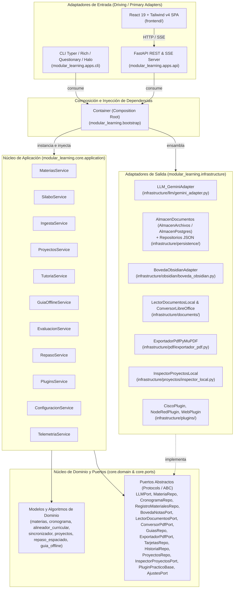

# 🏛️ Arquitectura Hexagonal y Diseño del Sistema — Modular Learning

`modular-learning` es una plataforma académica para organizar asignaturas y cronogramas, ingestar material de estudio hacia [Obsidian](https://obsidian.md/), estudiar mediante tutoría guiada con IA o cuadernos offline en PDF A5 y programar repasos espaciados (SM-2).

El sistema está estructurado bajo **Arquitectura Hexagonal (Puertos y Adaptadores)** e **Inversión de Control (IoC)**, garantizando que el núcleo de negocio (`modular_learning.core`) sea independiente de marcos de trabajo web, herramientas de línea de comandos, sistemas de archivos y proveedores externos.

---

## 📐 Diagrama de Arquitectura y Dependencias

---

## 🧩 Capas del Sistema

### 1. Dominio (`modular_learning.core.domain`)
Contiene las entidades, estructuras de valor y algoritmos puros de negocio (sin acceso a disco, red ni librerías externas):
- **`materias.py`**: Entidad `Materia(slug, nombre)` y funciones de normalización idempotente (`slug_materia`, `buscar_materia`).
- **`cronograma.py`**: Generación y validación de identificadores únicos de clase (`nuevo_id_clase`, `asegurar_ids_clases`, `asignar_ids`, `buscar_clase_por_id`).
- **`alineador_curricular.py`**: Algoritmo de vinculación entre un documento ingestado y la sesión correspondiente del cronograma (`asignar_material_a_clase`), o su registro como material transversal.
- **`sincronizador.py`**: Detección de archivos pendientes y huérfanos entre la carpeta de materiales y el registro de materiales procesados (`calcular_diferencias`).
- **`proyectos.py`**: Entidades `Proyecto` y `FaseProyecto` para el seguimiento de entregas prácticas por asignatura.
- **`repaso_espaciado.py`**: Entidades `TarjetaRepaso` y `EntradaHistorial`, e implementación de la variante del algoritmo **SM-2** (`programar_repaso`, `calcular_resumen`).
- **`guia_offline.py`**: Entidades `GuiaOffline` y `ClaseEnGuia` para cuadernos de estudio desconectados y su confirmación posterior.
- **Prompts (`modular_learning.core.prompts`)**: Plantillas Markdown cargadas con `importlib.resources` (`cargar_prompt`) para extracción de sílabos, ingesta, tutoría, guías offline y cuestionarios.

### 2. Puertos (`modular_learning.core.ports`)
Contratos (`typing.Protocol` y clases base abstractas) que definen cómo se comunica el núcleo con el exterior:
- **`llm.py` (`LLMPort`, `LLMAdapterBase`)**: Generación de texto, análisis multimodal con archivo adjunto, respuestas en *streaming* y parseo resiliente de JSON.
- **`repositorios.py`**: `MateriaRepo`, `CronogramaRepo` y `RegistroMaterialesRepo`.
- **`boveda.py` (`BovedaNotasPort`)**: Escritura, lectura, listado y borrado de notas Markdown e índices (`MOC`) en la bóveda de Obsidian.
- **`documentos.py` (`LectorDocumentosPort`)**: Extracción de texto y metadatos desde archivos locales y exploración de directorios sin usar `os` en el núcleo.
- **`conversor_pdf.py` (`ConversorPdfPort`)**: Conversión de documentos ofimáticos (`.pptx`) a un PDF temporal para lectura visual multimodal.
- **`guias.py` (`GuiasRepo`, `ExportadorPdfPort`)**: Persistencia de guías offline y maquetación de cuadernos en PDF A5.
- **`repaso.py` (`TarjetasRepo`, `HistorialRepo`)**: Almacenamiento de tarjetas SM-2 e historial de evaluaciones.
- **`proyectos.py` (`ProyectosRepo`, `InspectorProyectosPort`)**: Persistencia del catálogo de proyectos e inspección del árbol de archivos de un proyecto práctico.
- **`plugin_practico.py` (`PluginPracticoBase`, `PluginConfigRepoPort`)**: Contrato para plugins prácticos y su configuración de rutas y asignaturas vinculadas.
- **`config.py` (`AjustesPort`)**: Lectura y escritura de ajustes de rutas y claves de configuración.

### 3. Aplicación (`modular_learning.core.application`)
Once servicios de casos de uso que orquestan el dominio y los puertos mediante inyección de dependencias:
- **`MateriasService` (`materias.py`)**: Alta, renombrado (con preservación del `slug`) y eliminación de asignaturas junto con sus cronogramas, proyectos y registro de materiales asociados.
- **`SilaboService` (`silabo.py`)**: Extracción asistida por IA de sesiones desde sílabos `.pdf` o `.docx` y guardado del cronograma.
- **`IngestaService` (`ingesta.py`)**: Clasificación e ingesta de materiales (`.pdf`, `.docx`, `.pptx`, `.txt`, `.md`), generación de apuntes en Obsidian, alineación con el cronograma y limpieza consistente de materiales y referencias en cronogramas.
- **`ProyectosService` (`proyectos.py`)**: Extracción de guías de proyectos prácticos, seguimiento de cambios por huella, inspección de entregas de código, generación de notas del proyecto en Obsidian y eliminación sincronizada con el registro de materiales.
- **`TutoriaService` (`tutoria.py`)**: Generación del mapa de ruta de estudio, explicación paso a paso en *streaming*, resolución de dudas con contexto curricular/práctico y cierre de clase con resumen en Obsidian y tarjetas iniciales de repaso.
- **`GuiaOfflineService` (`guias.py`)**: Generación de cuadernos de estudio offline por clase o lote de clases, exportación a PDF A5 y confirmación posterior de clases entendidas o con dudas.
- **`EvaluacionService` (`evaluacion.py`)**: Generación de cuestionarios de recuerdo activo (opción múltiple y preguntas abiertas), calificación de respuestas abiertas con IA y registro del intento en el sistema de repaso espaciado.
- **`RepasoService` (`repaso.py`)**: Creación de tarjetas al completar sesiones, programación SM-2 tras cada intento y consulta de tarjetas vencidas, puntos débiles e historial.
- **`PluginsService` (`plugins.py`)**: Configuración de rutas y asignaturas vinculadas de cada plugin práctico y generación/lectura de su memoria técnica (`*_context.md`).
- **`ConfiguracionService` (`configuracion.py`)**: Consulta y persistencia de ajustes de usuario (`obsidian_vault`, `silabos_dir`, `material_dir`, `gemini_api_key`).
- **`TelemetriaService` (`telemetria.py`)**: Cálculo de estadísticas de avance por asignatura (clases completadas frente al total), porcentaje global del semestre y estado de plugins con memoria activa.

### 4. Infraestructura (`modular_learning.infrastructure`)
Implementaciones concretas de los puertos secundarios:
- **`infrastructure/persistence/almacen.py` (`AlmacenDocumentos`)**: Abstracción de almacenamiento clave-valor de documentos de texto:
  - `AlmacenArchivos`: lee y escribe de forma atómica bajo `data/` (o `ML_DATA_DIR`).
  - `AlmacenPostgres`: lee y escribe en la tabla `documentos (clave TEXT PRIMARY KEY, contenido TEXT, actualizado TIMESTAMPTZ)` de PostgreSQL cuando está definida la variable `DATABASE_URL`.
  - `DocumentoJson`: envoltorio tipado para leer/escribir documentos JSON sobre `AlmacenDocumentos`.
- **`infrastructure/persistence/json_repositorios.py`**:
  - `JsonMateriaRepo` (`data/config/materias.json`).
  - `JsonCronogramaRepo` (`data/schedules/<slug>_cronograma.json`).
  - `JsonRegistroMaterialesRepo` (`data/config/registro_materiales.json`).
  - `JsonPluginConfigRepo` (`data/config/plugins_config.json`).
  - `JsonProyectosRepo` (`data/config/proyectos.json`).
- **`infrastructure/persistence/json_ajustes.py` (`JsonAjustesRepo`)**: Persistencia en `data/config/ajustes.json` y actualización en memoria de `settings`.
- **`infrastructure/persistence/json_repaso.py`**: `JsonTarjetasRepo` (`data/repaso/tarjetas.json`) y `JsonHistorialRepo` (`data/repaso/historial.json`).
- **`infrastructure/persistence/json_guias.py` (`JsonGuiasRepo`)**: Persistencia de cuadernos en `data/guias/guias.json`.
- **`infrastructure/llm/gemini_adapter.py` (`LLM_GeminiAdapter`)**: Adaptador para Google Gemini (`google-genai`, modelo por defecto `gemini-3.5-flash-lite`) con rotación de modelos de respaldo y reintentos ante errores de cuota.
- **`infrastructure/obsidian/boveda_obsidian.py` (`BovedaObsidianAdapter`)**: Creación de apuntes Markdown con frontmatter YAML y actualización de índices `MOC - <Materia>.md`.
- **`infrastructure/documents/lector_documentos.py` (`LectorDocumentosLocal`)**: Extracción de texto desde `.pdf` (`pypdf`), `.docx` (`python-docx`), `.pptx` (`python-pptx`) y archivos de texto plano, además de utilidades de sistema de archivos para los servicios.
- **`infrastructure/documents/conversor_libreoffice.py` (`ConversorLibreOffice`)**: Conversión headless de `.pptx` a PDF temporal invocando `soffice --headless --convert-to pdf` (buscando en `ML_SOFFICE`, `PATH` y rutas estándar del sistema operativo).
- **`infrastructure/pdf/exportador_pdf.py` (`ExportadorPdfPyMuPDF`)**: Renderizado de Markdown a cuadernos PDF A5 mediante `markdown-it-py` y `fitz.Story` (PyMuPDF).
- **`infrastructure/proyectos/inspector_local.py` (`InspectorProyectosLocal`)**: Recorrido de directorios y lectura de código fuente de entregas prácticas (excluyendo `node_modules`, `.git`, `venv`, etc.).
- **`infrastructure/plugins/`**: Adaptadores de contexto práctico `CiscoPlugin` (`cisco.py`), `NodeRedPlugin` (`nodered.py`) y `WebPlugin` (`web.py`).

### 5. Adaptadores de Entrada (`modular_learning.apps` y `frontend/`)
- **`apps/cli/` (Interfaz de consola `ml`)**:
  - Construida con `Typer`, `Rich`, `Questionary` y `Halo` (`apps/cli/main.py`).
  - Subcomandos: `ml init`, `ml es`, `ml im`, `ml quiz`, `ml stats` y `ml up`, más la utilidad `apps/cli/commands/snapshot.py`.
- **`apps/api/` (Servidor Web `ml-web`)**:
  - Aplicación FastAPI (`apps/api/main.py`) con 11 routers en `apps/api/routers/` (`config`, `materias`, `silabo`, `material`, `proyectos`, `tutoria`, `guias`, `quiz`, `repaso`, `plugins`, `stats`), almacén de sesiones en memoria (`SessionStore`), middleware opcional de autenticación HTTP Basic (`AccesoBasico` en `apps/api/acceso.py`), endpoint de healthcheck `GET /api/salud` y servicio de archivos estáticos de la SPA desde `backend/src/modular_learning/apps/api/static/`.
- **`frontend/` (SPA en React 19 + TypeScript + Tailwind CSS v4 + Vite)**:
  - **Menú lateral de 5 entradas (`frontend/src/components/layout/Sidebar.tsx` y `frontend/src/App.tsx`)**:
    1. **Hoy** (`/` → `HoyView.tsx`): portada diaria con la clase de hoy o próxima, guías pendientes de confirmar, tarjetas de repaso vencidas, aviso de material sin convertir (en modo local/híbrido) y progreso por asignatura con resumen desplegable («Ver progreso completo»).
    2. **Estudiar** (`/estudiar` → `EstudiarView.tsx`): contenedor con tres pestañas:
       - **Tutoría** (`?tab=tutoria`, por defecto → `TutoriaView.tsx`).
       - **Repaso** (`?tab=repaso` → `QuizView.tsx`).
       - **Guía** (`?tab=guia` → `GuiaView.tsx`).
    3. **Calendario** (`/calendario` → `CalendarioView.tsx`): cuadrícula mensual con navegación entre meses y panel de detalle del día seleccionado.
    4. **Asignaturas** (`/asignaturas` → `AsignaturasView.tsx`): selector único de asignatura con alta/renombrado y tres pestañas:
       - **Clases** (por defecto → `SilabosView.tsx` embebido: cronograma, subida de sílabo, cortes de parcial y «Zona peligrosa» para vaciar clases o eliminar la asignatura).
       - **Material** (`?tab=material` → `MaterialView.tsx` en modo `materiales`: materiales convertidos en notas, subida de archivo suelto, escaneo de carpetas locales y «Zona peligrosa» para vaciar materiales y proyectos).
       - **Proyectos** (`?tab=proyectos` → `MaterialView.tsx` en modo `proyectos`: detección e ingesta de proyectos de asignatura y fichas registradas).
    5. **Ajustes** (`/ajustes` → `AjustesView.tsx`): contenedor con dos pestañas:
       - **Carpetas y clave** (`?tab=config`, por defecto → `ConfigView.tsx`).
       - **Plugins** (`?tab=plugins` → `PluginsView.tsx`).
  - **Vistas adicionales para guías offline** (`frontend/src/views/`):
    - `RevisionGuiaView.tsx` (`/guia/:id/revision`): confirmación de clases entendidas o con dudas al regresar del estudio desconectado.
    - `GuiaImprimirView.tsx` (`/guia/:id/imprimir`): vista limpia sin barra lateral para imprimir o guardar el cuaderno en PDF A5.
  - **Rutas anteriores con redirección (`RedirigirConQuery` en `frontend/src/App.tsx`)**: `/tutoria`, `/repaso`, `/quiz`, `/guia`, `/progreso`, `/plugins`, `/config`, `/silabos` y `/material` redirigen a su ubicación en el menú de 5 entradas conservando los parámetros de búsqueda (`?materia=...`, etc.).

### 6. Contenedor de Inversión de Control (`modular_learning.bootstrap`)
La función `build_container(settings: Any | None = None) -> Container` en `backend/src/modular_learning/bootstrap.py` es el único **Composition Root** del sistema:
- Instancia todos los adaptadores de infraestructura y plugins.
- Inyecta las dependencias en los 11 servicios de aplicación.
- Es consumido tanto por la CLI (`get_container()`) como por la API FastAPI (`Depends(get_container)` en `apps/api/dependencies.py`), permitiendo sustituir cualquier dependencia en las pruebas mediante `fake_adapters.py` o `create_app(container=...)`.

---

## 🔒 Control de Fronteras Arquitectónicas (`import-linter`)

El aislamiento entre capas se verifica automáticamente con `import-linter` según los tres contratos definidos en `backend/pyproject.toml`:

| Contrato | Módulo origen | Módulos prohibidos |
| :--- | :--- | :--- |
| **Core es agnóstico** | `modular_learning.core` | `modular_learning.infrastructure`, `modular_learning.apps`, `modular_learning.settings`, `modular_learning.bootstrap`, `typer`, `rich`, `questionary`, `halo`, `fastapi`, `google`, `pypdf`, `docx`, `pptx`, `dotenv` |
| **El dominio no depende de los casos de uso** | `modular_learning.core.domain` | `modular_learning.core.application` |
| **Infraestructura solo depende de los puertos del core** | `modular_learning.infrastructure` | `modular_learning.apps`, `modular_learning.bootstrap`, `modular_learning.core.application` |

Además, un test de arquitectura en la suite unitaria verifica que ningún módulo de `core/` realice llamadas directas de entrada/salida (`open`, `os.walk`, `os.listdir`, `os.remove`, `os.stat`, `os.path.isdir/isfile/exists`, `print`).

---

## 📦 Grupos de Instalación (`backend/pyproject.toml`)

Desde la raíz del repositorio:

| Comando | Descripción |
| :--- | :--- |
| `pip install -e "./backend[cli]"` | Consola interactiva (`typer`, `rich`, `questionary`, `halo`). |
| `pip install -e "./backend[web]"` | Servidor web FastAPI (`fastapi`, `uvicorn[standard]`, `python-multipart`). |
| `pip install -e "./backend[nube]"` | Soporte de persistencia en PostgreSQL (`psycopg[binary,pool]`). |
| `pip install -e "./backend[dev]"` | Herramientas de prueba y calidad (`pytest`, `pytest-mock`, `httpx`, `ruff`, `import-linter`, `pre-commit`). |
| `pip install -e "./backend[all]"` | Instala todos los grupos anteriores (`cli`, `web`, `nube`, `dev`). |
